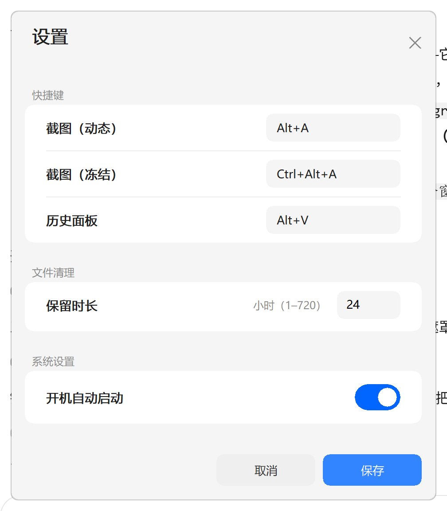

# SnipTool-RS

**A screenshot tool for Windows that fits in 0.46 MB and idles at 0.34 MB of RAM.**

Pure Rust + Win32. No Electron, no WebView, no .NET, no installer, no runtime to
download — a single `sniptool.exe` you can put anywhere and run.

> 中文说明见 [README.zh-CN.md](README.zh-CN.md)



---

## Why another screenshot tool?

Screenshot utilities are the poster child for "simple problem, absurd footprint".
A typical cross-platform screenshot app ships a browser engine to draw a menu and
sits at 100–300 MB. This one does the same job with GDI and a message loop:

| | SnipTool-RS | Typical Electron-based tool |
|---|---|---|
| Download | **474 KB** | 60–150 MB |
| Idle RAM (working set) | **0.34 MB** | 100–300 MB |
| Runtime required | none | bundled Chromium |
| Installer | none (portable) | NSIS/MSI |
| Time to first pixel after hotkey | ~40 ms | 300–800 ms |

The whole thing is ~5.4 k lines of Rust across 21 files, and you can read all of it
in an afternoon.

## Features

- **Two capture modes**
  - *Quick* (`Alt+A`) — the overlay is a real hole in the window; what you see is
    the live desktop. Release the mouse and it is already saved and on your
    clipboard. No confirmation step, no toolbar.
  - *Frozen* (`Ctrl+Alt+A`) — the screen is captured once on hotkey press, so the
    image is perfectly still. Move / resize the selection with 8 handles, then
    `Enter` to confirm or `Esc` to cancel.
- **Global hotkeys**, all rebindable in the settings window (and in a text config file)
- **History panel** (`Alt+V`) — last 10 shots as thumbnails; click one to put the
  original back on the clipboard
- **Clipboard first** — every capture goes straight to the clipboard as both
  `CF_DIB` and `CF_PNG`
- **Auto cleanup** — images older than N hours are deleted by timestamp only,
  never by reading image data
- **Tray-only** — no taskbar clutter, no main window; optional silent autostart
- **Modern UI drawn with GDI** — cards, a sliding toggle, flat buttons. No UI
  toolkit, no theme engine, 19 GDI objects total.

## Numbers

Measured on Windows 11 23H2, 2560×1600 @ 200 % scaling, release build:

| Metric | Value |
|---|---|
| Executable | 474 KB (single file) |
| Working set, idle | 0.34 MB |
| Private commit | 2.1 MB |
| Peak (startup) | 11.8 MB |
| Handles / GDI objects, idle | 153 / 7 |
| Rust source | ~5.4 k lines, 21 files |
| Dependencies | `image` (PNG only), `windows-sys` |

About the 0.34 MB: after startup and after every capture the app calls
`SetProcessWorkingSetSize(-1, -1)`. That does **not** free memory — it moves cold
pages to the standby list, where they stay until something touches them again
(a soft fault, microseconds). Private commit stays at 2.1 MB and that is the real
cost. The number is reported here because Task Manager reports it, and this app
genuinely has nothing to keep resident.

## Install

1. Download `sniptool.exe` from [Releases](../../releases).
2. Put it anywhere and run it. It appears in the tray.
3. Optional: enable *Start with Windows* in the settings (writes
   `HKCU\Software\Microsoft\Windows\CurrentVersion\Run`).

There is no installer. To uninstall: quit from the tray menu, delete the exe and
`%APPDATA%\SnipTool-RS`.

## Usage

| Action | Default |
|---|---|
| Quick capture | `Alt+A` |
| Frozen capture | `Ctrl+Alt+A` |
| History panel | `Alt+V` |
| Confirm / cancel a frozen selection | `Enter` / `Esc` |
| Right-click during a capture | cancel |

All three hotkeys can be changed in **tray menu → 设置 (Settings)**, or by editing
`%APPDATA%\SnipTool-RS\config.ini`:

```ini
quick=Alt+A
frozen=Ctrl+Alt+A
history=Alt+V
retention_hours=24
autostart=1
```

If a hotkey is already taken by another program, registration fails silently
(there is no popup) — the tray tooltip and the tray menu will say so, and you can
rebind it. `Alt+A` is the one most likely to clash in a Chinese environment
(QQ/WeChat use it by default); the tray menu still lets you capture without it.

## Build

Requirements: Rust (MSVC toolchain) and the Windows SDK (for `rc.exe`, used to
embed the icon and version resource). If `rc.exe` is missing, the build still
succeeds and warns — the exe just has no icon.

```powershell
cargo build --release
.\target\release\sniptool.exe
```

Cross-compiling from Linux with the `gnu` toolchain is not supported (the resource
step and some `windows-sys` bindings assume MSVC).

The icons are committed as build inputs (`assets/app.ico` plus the two monochrome
tray variants) — there is no icon build step. To change one, edit the `.ico` with
your own tool and point `assets/app.rc` at it; `build.rs` picks it up on the next
build.

## Test

```powershell
cargo test          # 12 headless unit tests: hotkey parsing, config round-trip, filename parsing
```

The UI side (overlay geometry, hotkeys, clipboard, repaint artefacts) was verified
with a PowerShell harness that drives the real binary through synthetic mouse and
keyboard input. That harness is **not part of this repository**: it moves the
mouse, takes over the screen for several seconds, and temporarily writes to
`HKCU` and `%APPDATA%`. Shipping something that rewrites a stranger's startup
entries is not worth it, so it stays out of the published tree.

## How it works

A few decisions that are not obvious, and why:

**The selection is a hole in the window.** The overlay is a layered window filled
with 47 % black. When you drag, `SetWindowRgn` cuts the selection *out of the
window itself* — the pixels you see inside the selection do not belong to us at
all. That is why the quick mode never allocates a full-screen bitmap: a 4K
screenshot would otherwise cost 33 MB before you even decided what to crop.

**Frozen mode captures before it creates any window**, because otherwise the
capture would contain our own overlay. The image is then shown by an *opaque*
window placed underneath the overlay, so the hole reveals a static bitmap.

**Never draw onto a layered window.** Any pixel painted on a window with
`LWA_ALPHA` gets blended with whatever is behind it, a second time. An early
version "froze" the selection by blitting the screenshot back onto the overlay and
the result looked grey and ghosted. The rule is: the overlay draws only the mask,
the frame and the label.

**Thumbnails are generated at capture time**, while the full-resolution DIB is
already in hand — one `StretchBlt` to 256×144, saved as a ~10 KB PNG. The history
panel decodes only those ten small images (≈1.5 MB), never the originals. Reading
ten 4K PNGs to show ten thumbnails would cost 330 MB.

**The settings window is drawn from scratch**, so it can look like 2026 instead of
1998. Native buttons ignore `WM_CTLCOLORBTN` once visual styles are on; the only
way to recolour them is `BS_OWNERDRAW`, which is just custom drawing with extra
steps. The single native control left is the number field, because an `EDIT` gives
you caret, selection, IME and clipboard for free.

**The dirty rectangle is the painted bounding box, not the selection.** The size
label is anchored at the selection's left edge and is much wider than a narrow
selection. Deriving the dirty rect from the selection alone left the tail of the
label outside it — it got painted once and then never erased, which looked like
stretched, doubled text while dragging. `frame_bbox()` now returns "everything
this frame can touch" and both the painter and the invalidation use it.

**Everything is double-buffered.** A `WM_PAINT` that draws forty GDI calls straight
onto the window DC gets composited mid-way, and you can see the background before
the cards land — that is the flicker. Each paint now goes into an offscreen DC and
reaches the screen in a single `BitBlt`.

## Antivirus and SmartScreen

This is an unsigned binary, so:

- **SmartScreen will show "Windows protected your PC"** on first run until the
  download earns reputation. That is unavoidable without a code-signing
  certificate (an OV certificate is ~$200/year; an EV one clears it immediately).
- Some engines may flag a *new, unsigned* binary that (a) installs a global
  hotkey, (b) captures the screen, (c) writes to the clipboard and (d) writes a
  `Run` registry value. All four are the actual features, but together they look
  like a keylogger to a heuristic.
- If you get a false positive, please open an issue with the engine name and
  version — the fix is usually a submission to the vendor, and those get resolved.

You do not have to trust the binary: it is 5 k lines, `cargo build` takes 5
seconds, and the release profile is `opt-level="z"`, LTO, `panic=abort`, stripped.

## Limitations

- Windows 10/11 only. The window uses `DwmSetWindowAttribute(DWMWA_WINDOW_CORNER_PREFERENCE)`
  on Windows 11 and falls back to a hard-edged region elsewhere.
- Single-monitor aware: the UI is laid out with the *system* DPI, so dragging the
  settings window to a monitor with a different scale factor does not re-layout.
  The capture overlay itself does handle the whole virtual screen.
- Light theme only.
- Quick mode has no undo — that is the point of it. Use frozen mode when you need
  to adjust the selection.

## License

MIT. See [LICENSE](LICENSE).
