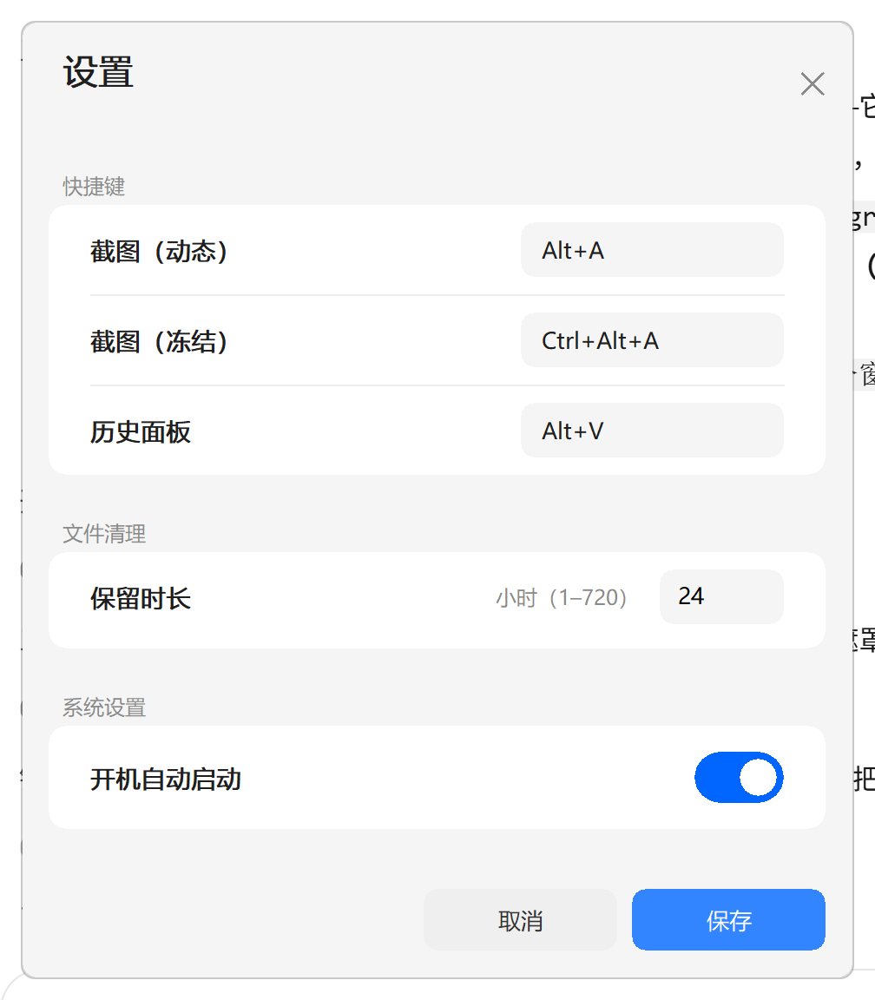

# SnipTool-RS

**一个 0.46 MB、常驻 0.34 MB 内存的 Windows 截图工具。**

纯 Rust + Win32 实现。没有 Electron，没有 WebView，没有 .NET，没有安装包，
没有需要另外下载的运行时 —— 就一个 `sniptool.exe`，放哪儿都能跑。

> English: [README.md](README.md)



---

## 为什么还要再造一个截图工具

截图工具大概是"问题很简单、体积很离谱"的典型：为了画一个菜单，套一个浏览器内核，
动辄占 100–300 MB。这个工具用 GDI 和消息循环做同样的事：

| | SnipTool-RS | 常见的 Electron 截图工具 |
|---|---|---|
| 下载体积 | **474 KB** | 60–150 MB |
| 空闲内存（工作集） | **0.34 MB** | 100–300 MB |
| 依赖运行时 | 无 | 自带 Chromium |
| 安装包 | 无（绿色） | NSIS/MSI |
| 按热键到出画面 | 约 40 ms | 300–800 ms |

全部代码约 5400 行 Rust、21 个文件，一个下午能读完。

## 功能

- **双模式截图**
  - *动态*（`Alt+A`）—— 遮罩上真的挖了个洞，洞内是你眼前的实时桌面。松手即落盘并
    进剪贴板，没有待确认、没有工具栏。
  - *冻结*（`Ctrl+Alt+A`）—— 按下热键的瞬间抓一张全屏，画面绝对静止。8 个手柄
    可移动/缩放选区，`Enter` 确认，`Esc` 取消。
- **全局热键**，三个都能在设置里改（也能直接改配置文件）
- **历史面板**（`Alt+V`）—— 最近 10 张缩略图，点一下就换回原图到剪贴板
- **剪贴板优先** —— 每张截图同时以 `CF_DIB` 和 `CF_PNG` 写入剪贴板
- **自动清理** —— 按时间戳删除过期图片，全程不读图像数据
- **只有托盘** —— 不占任务栏、没有主窗口，可选静默开机自启
- **用 GDI 手绘的现代界面** —— 卡片、滑动开关、扁平按钮。不引任何 UI 库，
  整个设置窗口只有 19 个 GDI 对象。

## 实测数字

Windows 11 23H2，2560×1600 @ 200% 缩放，release 构建：

| 指标 | 数值 |
|---|---|
| 可执行文件 | 474 KB（单文件） |
| 空闲工作集 | 0.34 MB |
| 私有提交内存 | 2.1 MB |
| 峰值（启动瞬间） | 11.8 MB |
| 句柄 / GDI 对象（空闲） | 153 / 7 |
| Rust 源码 | 约 5400 行，21 个文件 |
| 依赖 | `image`（仅 PNG）、`windows-sys` |

关于那 0.34 MB：启动后和每次截图后都会调一次 `SetProcessWorkingSetSize(-1, -1)`。
这**不是释放内存**，只是把冷页移进 standby list，下次访问是软缺页（微秒级）。
私有提交一直是 2.1 MB，那才是真实成本。之所以按这个口径报，是因为任务管理器
显示的就是它，而这个程序确实没有任何需要常驻的东西。

## 安装

1. 从 [Releases](../../releases) 下载 `sniptool.exe`
2. 放到任意目录，双击运行，它会出现在托盘里
3. 需要开机自启就进设置打开（写 `HKCU\Software\Microsoft\Windows\CurrentVersion\Run`）

没有安装包。卸载：托盘菜单退出，删掉 exe 和 `%APPDATA%\SnipTool-RS` 即可。

## 使用

| 操作 | 默认键 |
|---|---|
| 动态截图 | `Alt+A` |
| 冻结截图 | `Ctrl+Alt+A` |
| 历史面板 | `Alt+V` |
| 冻结态确认 / 取消 | `Enter` / `Esc` |
| 框选中右键 | 取消 |

三个热键都可以在**托盘菜单 → 设置**里改，也可以直接编辑
`%APPDATA%\SnipTool-RS\config.ini`：

```ini
quick=Alt+A
frozen=Ctrl+Alt+A
history=Alt+V
retention_hours=24
autostart=1
```

热键被别的程序占用时不会弹窗打断你：托盘提示和菜单里会说明是哪几个没注册上，
改绑就行。国内环境下 `Alt+A` 最容易被 QQ / 微信占，此时可以完全用托盘菜单截图。

## 构建

需要 Rust（MSVC 工具链）和 Windows SDK（提供 `rc.exe`，用来嵌图标和版本信息）。
找不到 `rc.exe` 时构建**不会失败**，只是产物没有图标。

```powershell
cargo build --release
.\target\release\sniptool.exe
```

改了 `tools/make_icons.py` 之后重新生成图标：

```powershell
python tools/make_icons.py
```

## 测试

```powershell
cargo test     # 12 个无头单测：热键解析、配置往返、文件名解析
```

集成测试是 `tools/` 下的 PowerShell 脚本，驱动真实二进制、注入鼠标键盘，
**会短暂接管屏幕**：

```powershell
powershell -ExecutionPolicy Bypass -File tools\spike5-smoke.ps1    # 16 项行为断言
powershell -ExecutionPolicy Bypass -File tools\focus-keys.ps1      # 真实按键：Enter / Esc / 焦点
powershell -ExecutionPolicy Bypass -File tools\spike5-ghost.ps1    # 重绘残留的像素级回归
powershell -ExecutionPolicy Bypass -File tools\settings-toggle.ps1 # 开关 → 配置 → 注册表 往返
```

每个脚本都会备份并还原它碰过的 `config.ini` 和注册表项。

## 几个不显然的设计

**选区是窗口上的一个洞。** 遮罩是 47% 黑的分层窗口，拖拽时用 `SetWindowRgn` 把
选区从窗口本身裁掉 —— 洞里那些像素**根本不属于我们**。这就是动态模式从不分配
全屏位图的原因：否则 4K 屏在你还决定要截哪儿之前就先吃掉 33 MB。

**冻结模式在任何窗口创建之前抓屏**，否则会把自己的遮罩拍进去。抓到的图由一个
**不透明**窗口垫在遮罩下面显示，洞内露出的就是那张静态照片。

**永远不要往分层窗口上画画。** `LWA_ALPHA` 窗口上的任何像素都会和身后的东西再混
一次。早期版本把截图 BitBlt 回遮罩上来"冻结"，结果发灰、重影、视频还在动。规矩是：
遮罩只画蒙版、边框和标签。

**缩略图在截图那一刻生成**，此时全分辨率 DIB 本来就在手里，一次 `StretchBlt` 到
256×144，存成约 10 KB 的 PNG。面板只解这 10 张小图（≈1.5 MB）。为了 10 个缩略图
去解 10 张 4K 原图是 330 MB。

**设置窗口是整窗自绘的**，所以看起来像 2026 而不是 1998。启用视觉主题后原生按钮
会**直接忽略** `WM_CTLCOLORBTN`，想改色只能 `BS_OWNERDRAW` —— 那已经是自绘，只是
多套了个壳。唯一保留的原生控件是数字输入框，因为 `EDIT` 白送光标、选区、输入法和
右键菜单。

**脏区按"这一帧画了什么"算，不是按选区算。** 尺寸标签锚在选区左边缘、比窄选区宽
得多，只按选区推脏区会让标签尾部落在脏区外 —— 画上去一次就再没人擦，表现为快速
拖拽时文字被拉长、重影。

**全部双缓冲。** 一个 `WM_PAINT` 里几十个 GDI 调用直接画到窗口 DC，会被 DWM 分块
合成，能看到"只有底色、卡片还没上"的中间态 —— 那就是闪烁。

## 杀毒软件与 SmartScreen

这是**未签名**的二进制，所以：

- 首次运行会看到 **SmartScreen「Windows 已保护你的电脑」**。没有代码签名证书
  （OV 证书约 200 美元/年，EV 证书可立即清除提示）就无法避免。
- 某些引擎可能对"新的、未签名的、同时具备：注册全局热键 + 抓屏 + 写剪贴板 +
  写 Run 注册表项"的程序报警 —— 这四条都是实打实的功能，但凑一起在启发式眼里
  很像键盘记录器。
- 如果遇到误报，请带上引擎名称和版本开 issue。这类问题通常通过向厂商提交样本解决。

你也可以完全不信任这个二进制：全部 5400 行代码，`cargo build` 5 秒，
release 配置是 `opt-level="z"` + LTO + `panic=abort` + strip。

## 已知限制

- 只支持 Windows 10/11。Win11 上窗口用 `DwmSetWindowAttribute` 拿系统圆角，
  其它版本退回硬边 region。
- 设置窗口按**系统 DPI** 布局，拖到另一块不同缩放的显示器不会重排；
  截图遮罩本身是覆盖整个虚拟屏幕的，不受影响。
- 只有浅色主题。
- 动态模式没有撤销 —— 这就是它快的原因。需要调整选区就用冻结模式。

## 许可证

MIT，见 [LICENSE](LICENSE)。
